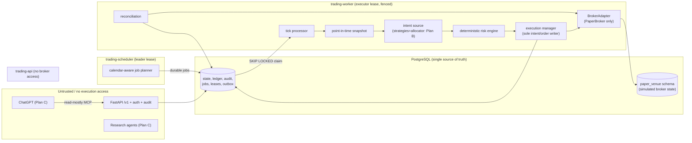

# Architecture overview

## Trust boundaries (enforced by tests in `tests/unit/test_architecture_boundaries.py`)

- Only the worker constructs a broker adapter. `trading.api` never imports `trading.brokers`,
  the execution manager or the bootstrap, directly **or transitively**.
- The API's only state-changing routes are `pause` and `resume-paper`. There is no route to place
  orders, change risk limits or switch mode.
- Risk is code, not prompt: `DeterministicRiskEngine` is a pure function of typed inputs; nothing
  an agent or headline says can alter it.
- Live mode cannot be expressed: `mode` is `Literal["PAPER_ONLY"]`, `accounts.mode` has a CHECK,
  and `allow_margin/short/options/crypto` are `Literal[False]`.

## Order path

`proposal -> risk engine -> persisted risk decision -> intent + CREATED order -> submit`
Submission is two-phase: (A) verify fence, persisted decision and system state, then
`CREATED -> RISK_APPROVED -> SUBMITTING`; the broker is called outside any transaction; (B) record
the outcome. A timeout becomes `UNKNOWN` and is resolved by reconciliation against the broker, never
by resubmitting. Every write first asserts the executor lease **fencing token**, so a stale process
cannot write.

## Why the paper broker has its own schema

`paper_venue` holds the simulated broker's orders and fills. Its cash and positions are derived from
its own fills, never from the application ledger, so reconciliation compares two independent records.

## Key decisions

See `docs/decisions/README.md` and the roadmap (§1) for C1–C10, plus the rulings recorded while
building Plan A (decisions on settlement, halts, fail-closed behavior, fencing and idempotency).
